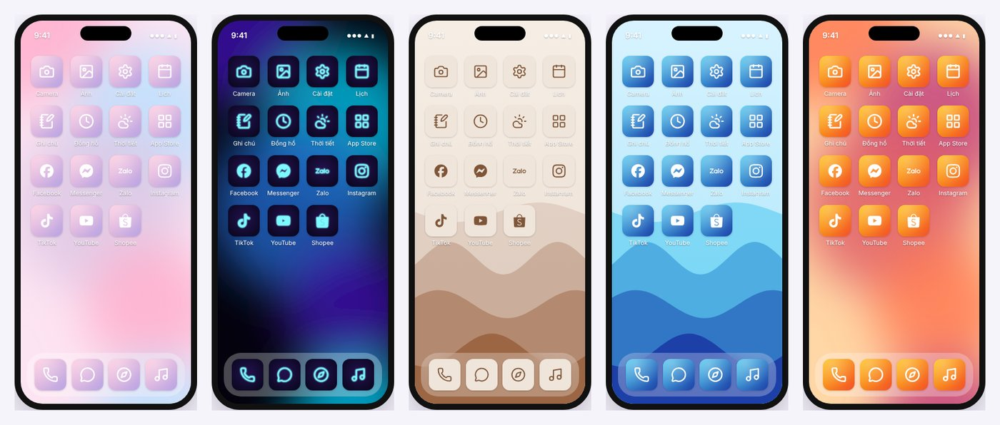

# Theme iPhone Studio

Tự thiết kế theme riêng cho iPhone: bộ icon, hình nền, rồi cài lên máy bằng một file profile.
Chạy ngay trên trình duyệt. **Không cần jailbreak, không cần Mac, không cần cài app.**



## Làm theme iPhone được tới đâu?

iOS không cho cài theme kiểu Android. Có hai hướng:

| | Không jailbreak (repo này) | Jailbreak |
|---|---|---|
| Đổi icon app | Có. Icon mới mở app gốc | Có. Thay thẳng icon gốc |
| Hình nền, widget | Có | Có |
| Số thông báo đỏ trên icon | Không | Có |
| Phông chữ, Trung tâm điều khiển, âm thanh | Không | Có (qua tweak) |
| Rủi ro | Gần như không có, gỡ là sạch | Ảnh hưởng bảo mật, app ngân hàng có thể chặn. iOS mới thường chưa có jailbreak |

Repo này đi theo hướng **không jailbreak**. Một theme gồm 3 phần:

1. **Bộ icon.** Toàn bộ icon được gói vào một file `.mobileconfig`. Cài một lần là icon hiện hết lên màn hình chính. Mỗi icon mở app tương ứng qua *URL scheme* (ví dụ `fb://` mở Facebook).
2. **Hình nền.** Ảnh PNG đúng độ phân giải đời máy của bạn.
3. **Icon cho Phím tắt.** Dành cho app không mở được bằng URL scheme (Camera, Máy tính, Shopee…). Bạn gắn icon cho chúng bằng app Phím tắt có sẵn trên iPhone.

## Cần những gì?

- iPhone chạy iOS 14 trở lên, dùng **Safari**.
- Repo GitHub này để đưa trang lên mạng, *hoặc* một máy tính bất kỳ.
- Không cần biết code. Muốn chỉnh sâu hơn thì chỉ cần một trình soạn thảo văn bản.

## Cách chạy

### Cách 1: Đưa lên GitHub Pages rồi mở thẳng trên iPhone (khuyên dùng)

1. Vào repo trên GitHub, chọn **Settings › Pages**.
2. Ở mục *Build and deployment*: **Source** chọn **Deploy from a branch**. **Branch** chọn nhánh chứa code (ví dụ `main`) và thư mục **/ (root)**, rồi bấm **Save**.
3. Đợi 1–2 phút. Trang sẽ có ở `https://vieetjk6-afk.github.io/Theme-iphone/`.
4. Mở link đó bằng **Safari trên iPhone**, thiết kế theme, rồi bấm **Cài bộ icon**.

Repo đang để công khai nên GitHub Pages miễn phí. Trang không lưu hay gửi dữ liệu của bạn đi đâu: mọi thứ được vẽ ngay trên điện thoại.

### Cách 2: Chạy trên máy tính

**Không cài gì cả:** tải repo về (**Code › Download ZIP**), giải nén, rồi **nhấp đúp `index.html`**.
Thiết kế xong, bấm **Tải trọn bộ (.zip)**. Sau đó gửi file `.mobileconfig` sang iPhone bằng AirDrop, hoặc gửi mail cho chính mình rồi mở bằng app **Mail**.

**Mở từ iPhone qua Wi‑Fi nhà** (máy tính cần cài [Node.js](https://nodejs.org)):

```bash
npm install
npm start
```

Lệnh `npm start` sẽ in ra địa chỉ dạng `http://192.168.x.x:8080`. Trên iPhone dùng chung Wi‑Fi, mở địa chỉ đó bằng Safari.

## Cài theme lên iPhone

1. **Bộ icon.** Bấm **Cài bộ icon**, rồi chọn **Cho phép** khi Safari hỏi. Vào **Cài đặt**, bấm dòng **Đã tải về hồ sơ** ngay dưới tên Apple ID, rồi chọn **Cài đặt**.
   Không thấy dòng đó thì vào **Cài đặt chung › VPN & Quản lý thiết bị**.
2. **Hình nền.** Bấm **Lấy hình nền**, nhấn giữ ảnh và chọn **Lưu vào Ảnh**. Sau đó vào **Cài đặt › Hình nền › Thêm hình nền mới**.
3. **App không có scheme** (nhãn *Phím tắt*). Bấm **Lấy icon cho Phím tắt** và lưu icon vào Ảnh.
   Mở app **Phím tắt**, bấm **+ › Thêm tác vụ › Mở ứng dụng** rồi chọn app. Bấm tên phím tắt và chọn **Thêm vào MH chính**. Bấm vào icon, chọn **Chọn ảnh** và lấy icon vừa lưu.
4. **Giấu icon gốc.** Nhấn giữ icon gốc, chọn **Xóa ứng dụng › Xóa khỏi MH chính**. App vẫn còn trong Thư viện ứng dụng, không mất dữ liệu.
5. **Gỡ theme.** Vào **Cài đặt chung › VPN & Quản lý thiết bị**, chọn profile **Theme: …** và bấm **Xóa hồ sơ**.

## Tự chỉnh bằng code

| File | Dùng để |
|---|---|
| `js/presets.js` | Thêm hoặc sửa mẫu theme: màu, kiểu icon, kiểu hình nền, danh sách đời máy |
| `js/apps.js` | Thêm app, sửa URL scheme mặc định, chọn app nằm ở dock |
| `js/render.js` | Cách vẽ icon và hình nền (SVG chuyển sang PNG) |
| `js/export.js` | Tạo file `.mobileconfig` và `.zip` |
| `js/app.js` | Giao diện và lưu lựa chọn |
| `scripts/build-glyphs.mjs` | Tạo lại `js/glyphs.js` khi muốn thêm biểu tượng (`npm install && npm run glyphs`) |

Thêm một mẫu theme của riêng bạn: chép một khối trong `js/presets.js` rồi đổi màu.

```js
{
  id: 'cua-toi', name: 'Theme của tôi',
  icon: { style: 'gradient', bg1: '#a0e7e5', bg2: '#b4f8c8', glyph: '#ffffff', scale: 0.5, stroke: 2 },
  wallpaper: { style: 'blobs', c1: '#fbe7c6', c2: '#a0e7e5', c3: '#ffaebc' },
},
```

- `icon.style` nhận một trong các giá trị: `gradient`, `solid`, `ring`, `neon`.
- `wallpaper.style` nhận một trong các giá trị: `blobs`, `gradient`, `waves`, `dots`.

Thêm app cố định: thêm một dòng vào `TIS.APPS` trong `js/apps.js`.

```js
{ id: 'myapp', name: 'Tên app', scheme: 'myapp://', glyph: 'star', group: 'other', on: true },
```

Bạn cũng có thể thêm app ngay trên trang, ở mục **+ Thêm app khác**. Cách này dùng được chữ hoặc emoji làm biểu tượng.

**Tìm URL scheme của một app:** gõ thử scheme (ví dụ `zalo://`) vào thanh địa chỉ Safari trên iPhone. Nếu Safari hỏi *“Mở trong Zalo?”* thì scheme đúng. Bạn cũng có thể tìm Google với từ khóa “*tên app* URL scheme iOS”.

## Lưu ý và sự cố thường gặp

- **Các URL scheme lấy từ tài liệu cộng đồng, chưa được thử trên máy thật.** Scheme có nhãn *Cần thử* là loại ít tài liệu hơn. Hãy bấm thử từng icon sau khi cài.
- **Bấm icon mà app không mở:** scheme sai, hoặc app đã đổi scheme. Sửa scheme trong danh sách, xuất lại profile với cùng tên theme rồi cài lại. Nếu bị trùng icon thì gỡ profile cũ trước.
- **Safari không hỏi tải profile:** hãy chắc chắn bạn đang dùng Safari, không phải Chrome hay trình duyệt trong Zalo/Facebook. Nếu vẫn không được, gửi file qua Mail rồi mở bằng app Mail.
- **iOS ghi “Chưa xác minh”:** bình thường, vì profile không có chữ ký số. Profile này chỉ chứa icon.
- **Icon không có số thông báo đỏ:** đây là giới hạn của iOS với mọi cách đổi icon không cần jailbreak.
- **Muốn ẩn tên dưới icon:** bật *Ẩn tên dưới icon* trên trang. Trên iOS 18 trở lên, bạn cũng có thể nhấn giữ màn hình và chọn **Sửa › Tùy chỉnh › Lớn**.

## Giấy phép

- Code: [MIT](LICENSE).
- Biểu tượng nét: [Lucide](https://lucide.dev) (ISC).
- Logo thương hiệu: [Simple Icons](https://simpleicons.org) (CC0).

Xem chi tiết trong [THIRD_PARTY_NOTICES.md](THIRD_PARTY_NOTICES.md). Các logo là nhãn hiệu của chủ sở hữu tương ứng, chỉ nên dùng cho mục đích cá nhân.
